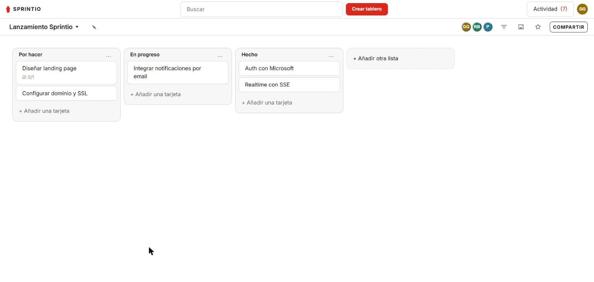
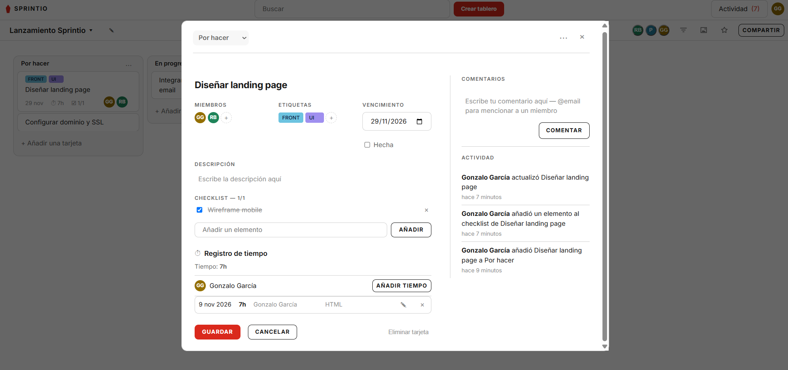

# Sprintio

A self-hosted Trello-style project management tool: workspaces, boards, lists and cards, with realtime updates, comments, attachments, time tracking and notifications.

## Stack

- **apps/web** — Angular 18 frontend
- **apps/api** — NestJS backend, Prisma + PostgreSQL, Redis (realtime/pubsub)
- **Caddy** — reverse proxy + automatic HTTPS in production
- Everything runs via `docker-compose.yml`

## Features

- Workspaces, boards, lists, cards, drag-and-drop
- Checklists, labels, comments, attachments, card archiving
- Time tracking per card
- Starred boards, custom board backgrounds
- Realtime updates and notifications (SSE)
- Auth: email/password or Microsoft sign-in (Azure AD), user admin panel
- Email notifications (SMTP)

## Capturas

| Tablero | Detalle de tarjeta |
|---|---|
|  |  |

## Local development

```sh
pnpm install
pnpm --filter api start:dev   # http://localhost:3000
pnpm --filter web start       # http://localhost:4200
```

The API needs Postgres and Redis running (see `docker-compose.yml` for the `db` and `redis` services, or point `DATABASE_URL`/`REDIS_URL` at your own).

## Production deployment

One Linux server with Docker handles everything:

```sh
docker compose --profile prod up -d --build
```

See [docs/deploy.md](docs/deploy.md) for environment variables, HTTPS/certificate setup, and backup/restore.

## Tests

```sh
pnpm --filter api test        # unit tests (vitest)
pnpm --filter api test:e2e    # API e2e tests (vitest)
pnpm --filter web test        # unit tests (Angular/Karma)
pnpm --filter web e2e         # browser e2e (Playwright), needs the stack running
```

## Decisiones técnicas

Las decisiones no obvias están documentadas como ADRs en [docs/adr](docs/adr):

- **Autorización por membresía de tablero**, no roles globales — Trello no tiene jerarquía de roles, el permiso es una relación persona-tablero ([0001](docs/adr/0001-board-membership-authorization.md)).
- **SSE en vez de WebSockets** para las actualizaciones en tiempo real — todas las escrituras ya van por REST, así que solo faltaba el sentido servidor→cliente, y `EventSource` lo da gratis con reconexión incluida ([0002](docs/adr/0002-sse-over-websockets.md)).
- **Un único log de eventos** alimenta tiempo real, actividad y notificaciones a la vez, en lugar de tres subsistemas separados ([0003](docs/adr/0003-single-event-log.md)).
- **Posiciones float dispersas** para el orden de listas/tarjetas por drag-and-drop — una sola fila se actualiza por movimiento, sin reescribir todos los hermanos ([0006](docs/adr/0006-float-positions.md)).

## Project structure

```
apps/
  api/     NestJS backend (auth, boards, cards, lists, events, realtime)
  web/     Angular frontend (boards, dashboard, account, admin)
docs/
  adr/         architecture decision records
  deploy.md    production deployment guide
  screenshots/ README images
docker-compose.yml
Caddyfile
```
